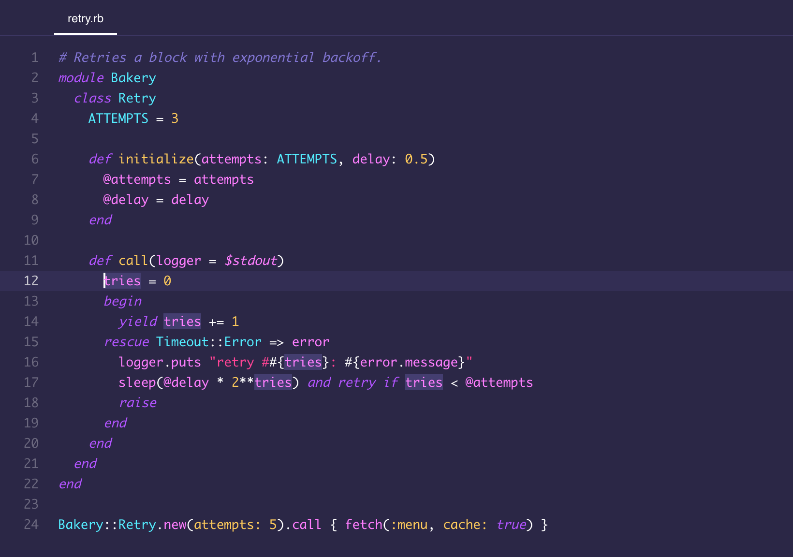

# Cupcake for JetBrains IDEs

A self-contained theme plugin: the dark **Cupcake** palette in the editor and across the
IDE's Islands UI.



## How the UI is themed

`Cupcake.theme.json` sets `"parentTheme": "Islands Dark"` and inherits all of its UI. It
replaces only the named colors that Islands Dark resolves its keys from. The IDE merges a
child theme's `colors` over its parent's before resolving names, so each override recolors
every key that refers to it, including keys that future IDE versions add. Requires the
Islands UI, which shipped in 2025.3.

- **Surfaces.** The `gray-*` ramp starts at the editor background, so the islands match the
  editor exactly. It steps through Cupcake's `#332E54`, `#3C3662` and `#443E70`, then mixes
  toward white for text and icons.
- **Window frame.** The toolbar, tool window stripes and status bar use `#221F38`, the
  color of Cupcake's VS Code title bar and status bar. The islands sit as lighter cards on
  top of it.
- **Accents.** Each Islands ramp keeps JetBrains' lightness and saturation per step and
  takes only its hue from Cupcake: blue → purple, red → pink, yellow → yellow,
  green → the ANSI green, teal → cyan. That keeps the contrast JetBrains tuned, such as
  white text on a primary button, while matching the palette.
- **Project gradients.** The nine per-project frame tints are rebuilt over the purple
  frame from Cupcake accents. Otherwise they paint it brown, olive or blue.
- **Literal colors.** About 30 keys in Islands Dark use hard-coded hex values instead of
  names: debugger values, Git log markers, scrollbars, file colors, sliders. These are
  set directly in `ui`.

The scheme pins no font. `EDITOR_FONT_NAME`, `EDITOR_FONT_SIZE`, `LINE_SPACING` and
`FONT_SCALE` are absent by design, so the global editor font settings win.

## Palette

| Role       | Hex       |
|------------|-----------|
| Background | `#2B2746` |
| Current line, popups | `#332E54` |
| Raised surface | `#3C3662` |
| Input, caret highlight | `#443E70` |
| Deep surface | `#221F38` |
| Selection  | `#613990` |
| Foreground | `#FFFFFF` |
| Comment    | `#8175D2` |
| Purple     | `#B254FF` |
| Pink       | `#FF4495` |
| Magenta    | `#FF7EFF` |
| Yellow     | `#FFCB5B` |
| Cyan       | `#54EDFF` |

Every color comes from the upstream `Cupcake-color-theme.json` except the selection, which
VS Code leaves at its stock blue. It is the theme's own `#B254FF80` list selection blended
onto the background, the same way the gutter, line numbers and indent guides are derived
from upstream's translucent white.

## Token mapping

Taken from upstream's TextMate scopes and checked against its screenshot:

| Token | Color |
|-------|-------|
| Keywords, booleans, `this` | purple italic |
| Strings | pink |
| Numbers, function calls | yellow |
| Variables, parameters, fields, properties | magenta |
| Classes, types, function and method declarations | cyan |
| Comments | comment italic |
| HTML/XML tag brackets / names / attributes | purple / magenta / yellow italic |
| Markdown headings / emphasis | purple bold / magenta |

Two departures, for keys VS Code's scopes have no equivalent for:

- **Ruby symbols are yellow.** Upstream matches no rule for `constant.other.symbol`, so
  symbols fall back to white text. Yellow keeps them apart from pink strings, the same
  `:symbol` vs `"string"` problem the Tomorrow port had to fix.
- **ANSI green is `#8AF27A`.** The palette has no green, and borrowing cyan would make
  green and cyan terminal output identical. It is the only color not drawn from upstream.
  The bright ANSI half mixes each color 22% toward white.

VCS uses cyan for added lines, purple for modified, pink for deleted, at 55–60% over the
background in the gutter and 20–25% in diff bands.

## Install

```
./build.sh
```

Then in the IDE: **Settings → Plugins → ⚙ → Install Plugin from Disk…**, pick
`dist/cupcake-1.2.0.zip`, restart, and select **Cupcake** under
**Settings → Appearance & Behavior → Appearance → Theme**.

No marketplace account, no network access, no build tooling beyond `jar` and `zip`.

Upgrading from a build before 1.2.0: uninstall the old plugin first. It used the ID
`com.rioam2.cupcake`, so the IDE treats this one as a separate plugin. The theme selection carries over.

## Layout

```
src/META-INF/plugin.xml      plugin manifest, registers the theme provider
src/META-INF/pluginIcon.svg  plugin icon
src/Cupcake.theme.json       UI theme, parentTheme="Islands Dark", generated
src/Cupcake.xml              editor color scheme, parent_scheme="Darcula", generated
tools/generate.py            writes both generated files from the palette
tools/preview.py             renders docs/preview.png from the scheme
build.sh                     packages src/ into dist/*.zip
```

## Generation

Upstream is VS Code only and has no JetBrains scheme to start from, so unlike the Tomorrow
port nothing is modernized in place. `tools/generate.py` writes the whole scheme from the
palette, and overwrites `src/Cupcake.xml` and `src/Cupcake.theme.json` on every run:

```
python3 tools/generate.py src
```

It sets 87 global colors and 204 attribute keys. The core is the semantic `DEFAULT_*` set,
which every modern language plugin inherits from. On top of that come the editor chrome,
inspections, the debugger, inlay hints, breadcrumbs, the console and block terminal, and
diffs, plus a few language keys (HTML, XML, CSS, JSON, YAML, Markdown, Ruby) whose
defaults don't follow `DEFAULT_*` closely enough. Anything left unset falls back to Darcula.

## Preview

`docs/preview.png` is rendered from the scheme itself, not captured from an IDE.
`tools/preview.py` tokenizes a sample Ruby file into the keys RubyMine's highlighter emits,
resolves each one through the same fallback chain the IDE uses, and screenshots the result
with headless Chrome in Monaco. Re-run it after changing colors:

```
python3 tools/preview.py src/Cupcake.xml docs/preview.png
```

## Credit

Palette by [Geoffrey](https://github.com/g3offrey), republished as
[rioam2/cupcake-ui](https://github.com/rioam2/cupcake-ui) under the MIT license. Ported to
JetBrains IDEs by [Dmitry Vorotilin](https://github.com/route).
